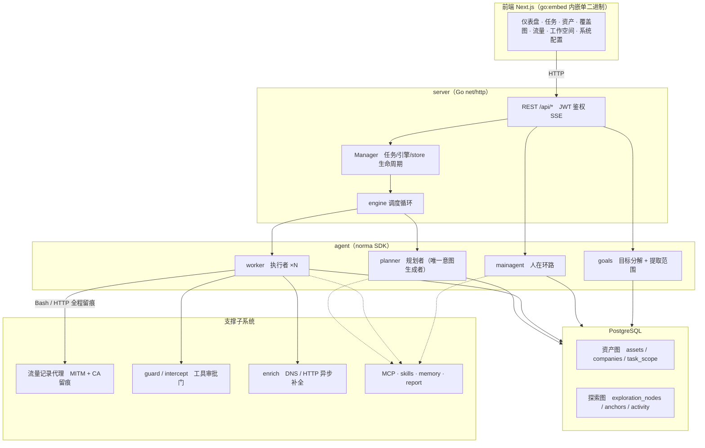
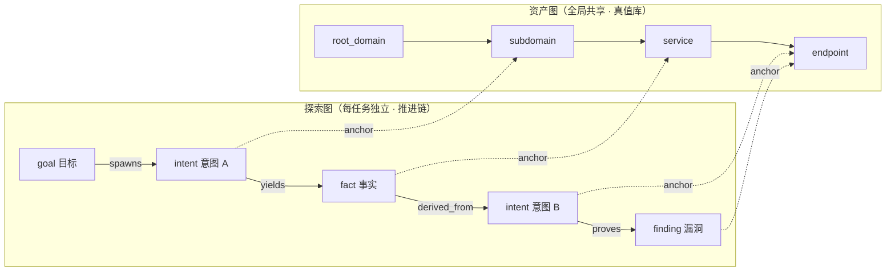
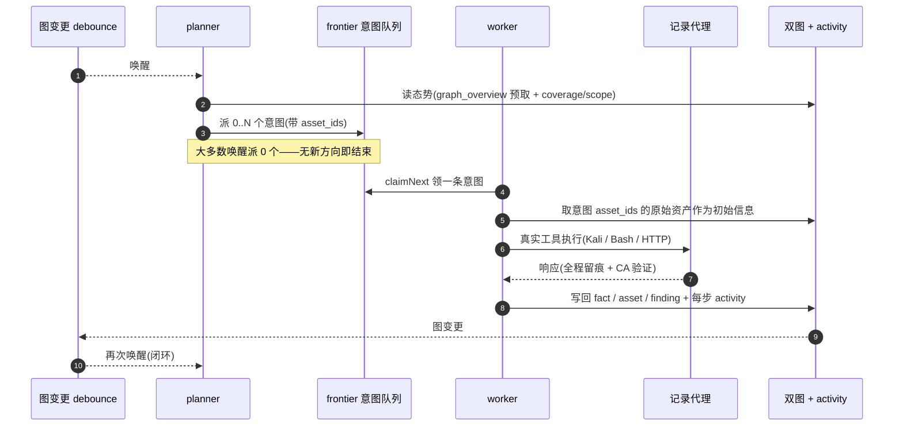
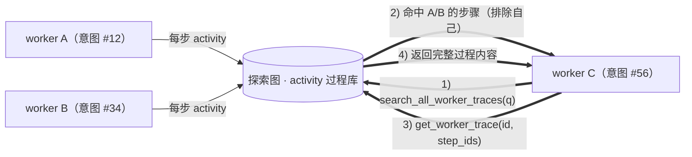
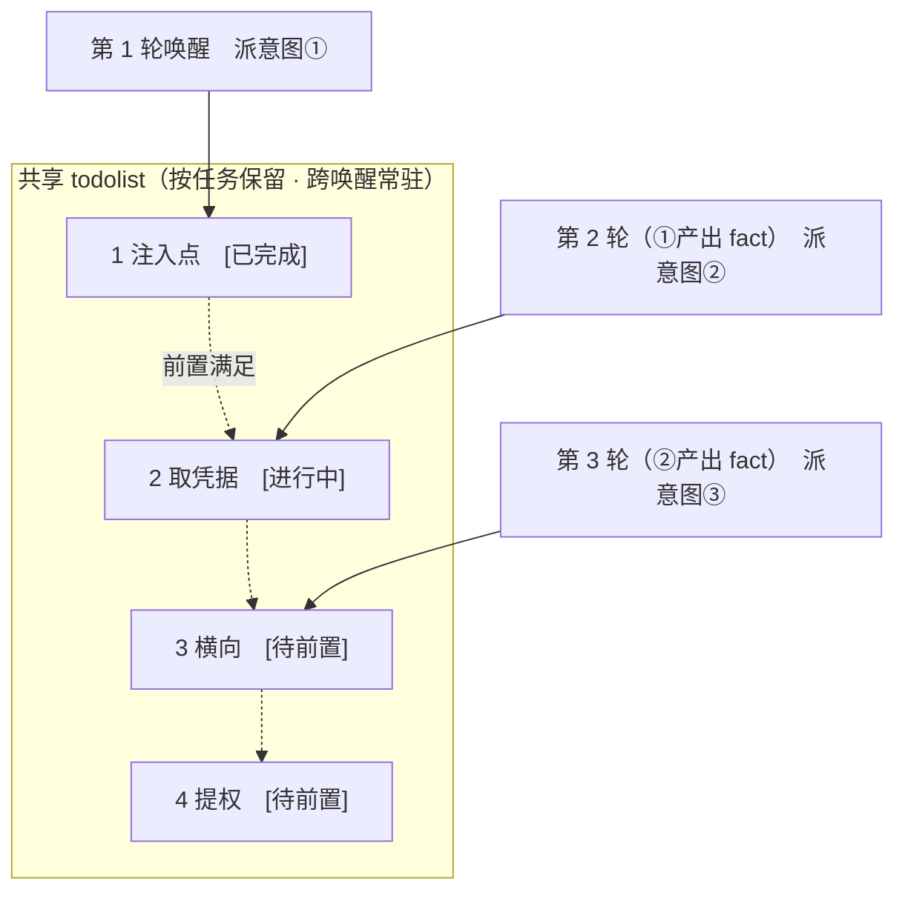

<div align="center">

# WSARTEX 详细说明

AI 自主渗透测试系统（Go 后端 + Next.js 前端）

[简明使用说明](README.md) · 原项目参考：**ARTEX**

**启动方式：装好 Python 后双击 `start.py`；停止运行 `quit.py`**（macOS / Linux / Windows 通用，不需要 Docker，见[安装与启动](#启动与停止)）

</div>

---

## 审批记录详情

全局「审批记录」、任务内「拦截审批」及对话中的审批卡片均支持展开查看详情，沿用本项目的组件和主题。


## 资产同步（ScopeSentry）

支持从 ScopeSentry 直接同步资产数据，免去重复收集：

- 在「**资产同步**」页填 ScopeSentry 的地址与 API Key，接入数据源；
- 按**项目**或**任务**维度选择要同步的目标与资产类型（域名 / 子域 / IP / 端口 / 站点 / 端点…）；
- 一键导入并按公司资产范围归并，直接进入 WSARTEX 的资产图供 agent 探索使用。

---

## 安装

> 依赖数据库 **PostgreSQL**；探索需配置 **LLM**（`ANTHROPIC_API_KEY` 或 `OPENAI_API_KEY`，也可在 UI 里配）。
>
> **跑起来只需要两步：装好 Python，然后运行 `start.py`。** 其余依赖（Go / Node / PostgreSQL）脚本会检测并在你确认后自动安装。

### 启动与停止

> **不需要 Docker。** 前置条件只有一个：本机已安装 **Python 3.8 或更高版本**。
> - macOS：在终端运行 `python3 --version` 确认已安装；如提示缺失可到 <https://www.python.org/downloads/> 下载安装。
> - Windows：到 <https://www.python.org/downloads/> 下载安装，**安装时勾选「Add Python to PATH」**。
> - Linux：`sudo apt install python3`（或发行版对应的包管理器）。

下载整个项目文件夹后，**双击 `start.py`**（或在项目根目录执行 `python3 start.py`）。它会：

1. **识别当前操作系统**（macOS / Linux / Windows），并据此选择后续的安装与启动方式
2. **检测外部依赖**：Go、Node.js、npm、PostgreSQL 客户端，以及可选的 nmap、ripgrep
3. 若有必需依赖缺失，**让你选择**：
   - `1` 退出运行，自己手动安装（脚本会打印对应系统的安装命令）
   - `2` 由脚本自动安装（macOS 用 Homebrew；Linux 按发行版选用 apt/dnf/pacman/zypper/apk；Windows 用 winget/choco/scoop）
4. 自动安装完成后，**让你选择**：`1` 退出运行，`2` 启动 WSARTEX
5. 若必需依赖齐全、但缺少可选工具（nmap / ripgrep），**再问一次**：`1` 跳过直接启动，`2` 安装后启动
6. 依赖就绪，**启动 WSARTEX**，并在默认浏览器中打开管理界面

启动过程还会自动完成：准备并启动 PostgreSQL（创建角色与数据库、随机生成密码）、生成 `config.json`（已存在则不覆盖）、构建前端、编译后端、后台启动服务并等待健康检查通过。

首次全流程约 **5–20 分钟**（取决于是否需要装依赖）；之后再次运行 `start.py` 只需数秒——已完成的步骤会自动跳过，检测到服务已在运行则直接打开浏览器。

**停止服务：运行 `quit.py`**（同样双击即可）。它会结束所有与 WSARTEX 相关的进程并确认端口已释放。数据库 PostgreSQL 属独立的系统服务，`quit.py` **不会**停止它；需要时它会打印对应命令。

```bash
python3 start.py    # 启动（检测依赖 → 构建 → 后台启动 → 打开浏览器）
python3 quit.py     # 停止（结束 WSARTEX 全部相关进程）
```

说明：

- 服务只监听 `127.0.0.1`，不对局域网开放；运行日志与 PID 在 `data/wsartex-launcher.log`、`data/wsartex-launcher.pid`（该目录已被 `.gitignore` 忽略）。
- 首次下载源码后需要联网安装外部工具和前端依赖。Go 依赖已包含在 `vendor/`，核心 SDK 源码在 `third_party/norma/`；`web/node_modules/` 与 `web/.npm-cache/` 不随仓库分发。启动器会按需运行 `npm ci`，已有本地缓存时会优先尝试离线安装，失败后联网重试。
- 无需手动新建 `data/`，启动器会自动创建；全新安装时也会生成 `config.json` 与登录签名密钥 `jwt.key`。
- 若 `config.json` 丢失但数据库角色已存在，启动器无法得知原密码，会提示你参考 `config.example.json` 手动补齐数据库连接配置，再重新启动。
- 自动化/无图形环境下启动：`python3 start.py` 同样可用，只是浏览器打开失败会给出提示而不中断。

---

## 更新

程序没有自动更新通道。使用 Git 下载的项目可在保存本地修改后手动运行 `git pull`；使用源码压缩包的项目则手动替换程序源码，并保留本地配置和数据。

更新代码后**重新运行 `start.py`**：它会自动判断哪些步骤需要重做，只重跑必要的部分。Go 依赖已包含在 `vendor/`；前端依赖可复用本地安装或缓存，新增或缺失的依赖需要联网安装。

> 升级只换程序、不动数据：PostgreSQL 数据库、`./data`（SQLite 流量索引、transcripts 等）、`./skills` 都会保留。**数据库迁移无需手动执行**——`wsartex` 每次启动会幂等重跑 `schema.sql`（含 `ADD COLUMN` / `CREATE INDEX IF NOT EXISTS`），即“重启即迁移”。升级前仍建议先备份 `./data` 与数据库。
>
> 注意 **JWT 签名密钥 `jwt.key` 存放在可执行文件同级目录**（即项目根目录），不在 `./data` 下。它决定登录态是否延续，备份时别漏。

---

## 配置

**数据库**（`config.json`，或用环境变量 `WSARTEX_PG_DSN` 覆盖）：

```json
{
  "database": {
    "host": "127.0.0.1", "port": 5432,
    "user": "wsartex", "password": "yourpass",
    "dbname": "wsartex", "sslmode": "disable"
  }
}
```

**LLM**：`export ANTHROPIC_API_KEY=sk-...`（或 `OPENAI_API_KEY`），也可在 UI 的「LLM 配置」页填写。
可选：`WSARTEX_LLM_PROVIDER` / `WSARTEX_LLM_MODEL` / `WSARTEX_LLM_BASE_URL` / `WSARTEX_LLM_PROXY`。

**并发**：每个任务的 work agent 数在「系统配置」里配置（默认 3）。

**恢复初始状态**：在「系统配置 → 清除所有数据」中输入当前登录密码并确认，可永久清除项目数据库中的历史与配置、`data/` 工作区及登录密钥，自动重启后进入首次设置密码页面。该操作不进入回收站、不自动备份；程序、数据库连接配置和项目 skills 文件保留。清除期间会停止后台任务，旧登录凭据随之失效。

**常用参数**：`./wsartex -addr :8787 -proxy :8788`（`-addr` 前端+API，`-proxy` 流量录制代理）。`start.py` 默认按该端口组合拉起服务。

### 远程 MCP（http / sse）

远程 MCP 可在系统设置中选择 `http`（Streamable HTTP）或 `sse`（旧版 SSE）。
旧版 SSE 服务通常使用 `GET /sse` 建立事件流，再通过服务返回的
`/message?sessionId=...` 接收 JSON-RPC 请求；配置时将 URL 填为 `/sse`，请求头按
`Authorization=Bearer <token>` 填写。

### 反向代理部署（HTTPS / 只开放 443）

前端和 API/SSE 都由同一个后端端口（默认 `:8787`）提供，实时活动流默认走**同源**地址，因此**无需配置 `NEXT_PUBLIC_SSE_BASE`**，公网只开放 443、把 8787 留在内网即可。

SSE 是长连接 + 持续推送，反代**必须关闭缓冲**，否则浏览器能连上却收不到事件（表现为活动流一直转圈）。Nginx 示例：

```nginx
server {
    listen 443 ssl;
    server_name your.domain.com;
    # ssl_certificate / ssl_certificate_key ...

    location / {
        proxy_pass http://127.0.0.1:8787;
        proxy_set_header Host $host;
        proxy_set_header X-Forwarded-Proto $scheme;

        # SSE 关键项：关缓冲、长超时、HTTP/1.1
        proxy_buffering off;
        proxy_cache off;
        proxy_read_timeout 3600s;
        proxy_http_version 1.1;
        proxy_set_header Connection "";
    }
}
```

> 仅当 SSE 需要走与页面不同的来源（如独立子域）时，才在**构建期**设置 `NEXT_PUBLIC_SSE_BASE`（该变量在 `next build` 时固化进静态包，容器运行时再设无效）。

---


## 开发

### 手动漏洞复测

任务详情的「复测」页签可分页选择本任务的漏洞、查看历次结论和证据，并手动发起复测。启动后保留当前页签，显示转圈图标和「复测中」；确认修复后同步更新漏洞状态。

在漏洞列表每行操作区点击「复测」，或在漏洞详情的「漏洞复测」区域点击「发起复测」，填写可选的修复版本、测试条件或限制，系统会创建独立的复测 Agent 会话，启动后保留当前页面。列表的平铺、按任务分组和资产视图均支持该入口；复测运行时显示转圈图标和「复测中」，需要查看时点击进入对应会话，结束后恢复「复测」。复测无需重新启动原扫描任务，结论分为「仍可复现」「已修复」「无法确认」，每次的结论、证据和会话链接保存在漏洞详情中。

新版后端首次启动会预置可编辑的「漏洞复测」（`retester`）Agent，可在 Agent 管理中配置提示词、LLM、运行预算和工具。默认使用其绑定的 LLM，未绑定则使用全局激活配置。复测会话成功完成且结论为「已修复」时，系统自动将漏洞处置状态改为「已修复」；执行中、失败、停止或其他结论保留原状态。原始证据和报告始终保留。也可在状态下拉菜单中手动选择「已修复」。同一漏洞正在复测时复用已有会话，停止、失败或服务重启后可重新发起。

本版历史记录通过漏洞详情和会话查看，暂未纳入漏洞报告导出或任务归档包，也未自动关联流量包。演示模式只生成明确标注的模拟记录，不请求真实目标。

### 本地运行与测试

日常使用只有两个入口：**启动 `start.py`、停止 `quit.py`**（见上一节「启动与停止」）。下面几条是改代码时用的命令：

- 后端：`go run ./cmd/wsartex`（不带 `-tags embedui` 则不内嵌前端）
- 前端：`cd web && npm run dev`（`/api` 反代到后端，带热更新）
- 测试：`./test.sh`（把测试指向独立的 `wsartex_test` 库；直接 `go test ./...` 会连上开发库，别这么跑）
- Mock 预览（无后端）：`cd web && NEXT_PUBLIC_MOCK=1 npm run dev`

---

## 系统技术架构

WSARTEX 是一套 **LLM 多 agent 驱动的自主渗透系统**：Go 单体后端（内嵌 Next.js 前端）+ PostgreSQL，agent 能力由 `norma` SDK 提供（`agentcore` / `tool` / `permission` / `harness` / `memory` / `transcript`）。核心是**双图架构**，以及围绕它的两条自主性机制：**worker 间过程级信息交换**与 **planner 多轮共享 todolist 稳定攻击链路**。

> **依赖与本地模块**：Go 依赖与核心 SDK 源码已包含在仓库中；首次构建仍需准备外部工具和前端依赖。
> - Go 依赖在 `vendor/`；前端通过 `npm ci` 安装，`web/node_modules/` 与本地缓存 `web/.npm-cache/` 均被 Git 忽略。
> - 核心 SDK **norma 的完整源码已收进仓库**，作为本地模块 `third_party/norma`（模块名 `wsartex/norma`），由 `go.mod` 的
>   `replace wsartex/norma => ./third_party/norma` 指向，不再依赖任何外部仓库。
> - **改 `third_party/norma` 的源码后，需要重跑一次 `go mod vendor`**，否则 `vendor/` 里仍是旧副本、构建不会生效。

### 总体分层



| 层 | 职责 |
| --- | --- |
| **前端** | Next.js 静态导出，`go:embed` 内嵌进单二进制；可视化任务/资产/探索链路/覆盖图，人在环路对话 |
| **server** | `net/http` 路由 + JWT 鉴权 + SSE；`Manager` 托管任务、引擎、DB store 的生命周期 |
| **engine** | 每任务一个 `plannerLoop` + N 个 worker goroutine；意图领取、超时/暂停/drain |
| **agent** | goals / planner / worker / mainagent，`ToolSet` 把双图暴露成 LLM 工具 |
| **db** | 双图的 Postgres 落地（pgx）；schema 随 `go:embed` 每次启动幂等建表 |
| **支撑** | 记录型 MITM 代理、审批门、异步补全、MCP/技能/记忆/报告 |

### 双图架构：探索图 + 资产图

系统把「**目标是什么**」和「**测到了什么程度**」拆成两张相互独立、又通过锚点相连的图：

- **资产图（Asset Graph，全局共享）**：跨任务同一份的资产真值库。节点为 `root_domain / subdomain / ip / service / app / endpoint`，归属公司；域名→子域→服务→端点的父子关系与去重 key 全部由程序计算，agent 只提交原始信息。
- **探索图（Exploration Graph，每任务独立）**：一次任务的“思考与推进”过程。节点为 `goal（目标）/ intent（意图）/ fact（事实）/ finding（漏洞）/ hint（提示）`，靠 `spawns / derived_from / yields / proves` 等边连成**血缘链**，回答“哪个方向派生自哪些事实、产出了什么”。
- **两图靠锚点相连**：`exploration_anchors(node_id, asset_id)` 把意图/事实/漏洞锚定到具体资产上——于是既能从“探索方向”看它打的是哪些资产，也能从“某个资产”反查它在本任务被哪些意图测过、得出过哪些事实。这也支撑了**资产测试覆盖度**与**资产覆盖图**（范围内资产 + 已测高亮）。



> 分工：**planner** 读探索图态势、判目标、只在有未覆盖的新方向时派**意图**进 frontier；**worker** 领**一条意图**、用真实工具执行、把新资产/事实/漏洞写回两图后即停。资产图是共享事实，探索图是每任务的推进链。

### 引擎与意图生命周期（一次探索的闭环）

引擎是**事件驱动**的闭环：图一变就唤醒 planner，planner 派意图，worker 领意图执行并写回，写回又触发下一轮——直到目标被证明（`prove_goal`）。



### worker 间的过程级信息交换

一次深入的探索里，很多有价值的观察（某个报错、某段响应、某个隐藏参数）出现在一个 worker 的**执行过程**中，却未必被写成正式 fact。为避免重复劳动、让链路上的 worker 能站在彼此的肩膀上，worker 具备**跨 work 检索过程**的能力：

- `search_all_worker_traces(q)`：在**本任务其他 work 的执行过程**里按关键字检索（自动排除自己这条意图的步骤），命中项带 `intent_id`；
- `list_worker_traces` / `get_worker_trace(intent_id, step_ids=[…])`：先看有哪些 work 跑过，再取某个 work 具体几步的完整内容做细节交换。

这样即便探索图上还没有对应的 fact，后续 worker 也能复用他人过程中的观察——**信息在 worker 之间以“执行过程”为粒度流动**，而边界不变（每个 worker 仍只做自己领到的那条意图）。



### planner 多轮共享 todolist → 稳定的攻击链路

真实攻击链往往是**有前后依赖的多步序列**（如：发现注入点 → 拿到凭据 → 横向 → 提权），一次性把这些并行派下去只会乱套。planner 因此持有一份**按任务保留、跨唤醒共享的规划待办（todolist）**：

- planner 是事件驱动的——图一变就被唤醒，但**每次唤醒是全新会话**；共享的 todolist 让它把一条串行利用链**记录一次**、然后在后续多轮里**按依赖逐步派意图**，而不是把整条链在一轮里全部前置展开；
- 每轮只对「前置步骤已完成、其依赖的 fact 已存在」的下一步派意图，并随进展更新清单（把已被 fact 满足的步骤标完成）。



于是攻击链在“事件驱动 + 无状态会话”的环境下依然**稳定推进、不重复、不错序**——这是 WSARTEX 能自主走完多步利用链的关键。

---

## 许可与免责声明

### 开源协议

本项目基于 ARTEX 修改，采用 **GNU Affero General Public License v3.0 或后续版本（AGPL-3.0-or-later）**。完整条款见 [LICENSE](LICENSE)，原项目来源、修改说明和第三方版权见 [NOTICE.md](NOTICE.md)。第三方组件仍保留各自的版权和许可证，不因本项目的整体授权而被替换。

以下是便于理解的摘要，具体权利义务以 LICENSE 及适用的第三方许可证为准：

- 可以使用、复制、修改和分发，也可以商业使用。
- 仅在本地自己使用或修改，且不分发、不向其他用户提供修改版的网络交互服务，通常无需公开修改后的源码。
- 分发原版或修改版时，应保留版权、许可和免责声明；修改版应注明修改及日期。受本协议覆盖的衍生作品应按 AGPL 授权；分发可执行程序时，还须按协议提供完整的对应源码。
- 修改版本支持用户通过网络交互时，须显著向这些用户提供免费获取该版本完整对应源码的方式。源码提供义务不等于必须公开数据库、密码、API Key 等运行数据或凭据。

### 使用建议与法律责任

建议先在本地隔离靶场中学习、研究和验证。对实际系统开展安全测试时，应事先取得必要授权，明确目标范围、测试方式及数据处理边界，并遵守适用法律法规。不得利用本工具从事非法入侵、数据窃取、勒索、拒绝服务等违法活动。

这些建议和法律责任提示不构成对 AGPL 所授予权利的额外限制，也不代替目标系统所有者的授权。

### 免责声明

在适用法律允许的范围内，本项目按“现状（AS IS）”提供，不附带任何明示或默示担保。作者、版权持有人及贡献者的免责与责任限制以 LICENSE 第 15、16 条及适用法律为准。使用者应自行评估使用风险，保护数据并履行相应的法律义务。
