# WSARTEX

用于个人学习与本地隔离环境技术验证的 AI 自主渗透测试系统。原项目参考：**ARTEX**。

本页为简单版使用说明，功能介绍、配置和技术架构见[详细版 README](README.detailed.md)。

## 截图预览

| 仪表盘（总览 / Token 消耗 / 活动流） | 任务列表 |
| :---: | :---: |
| 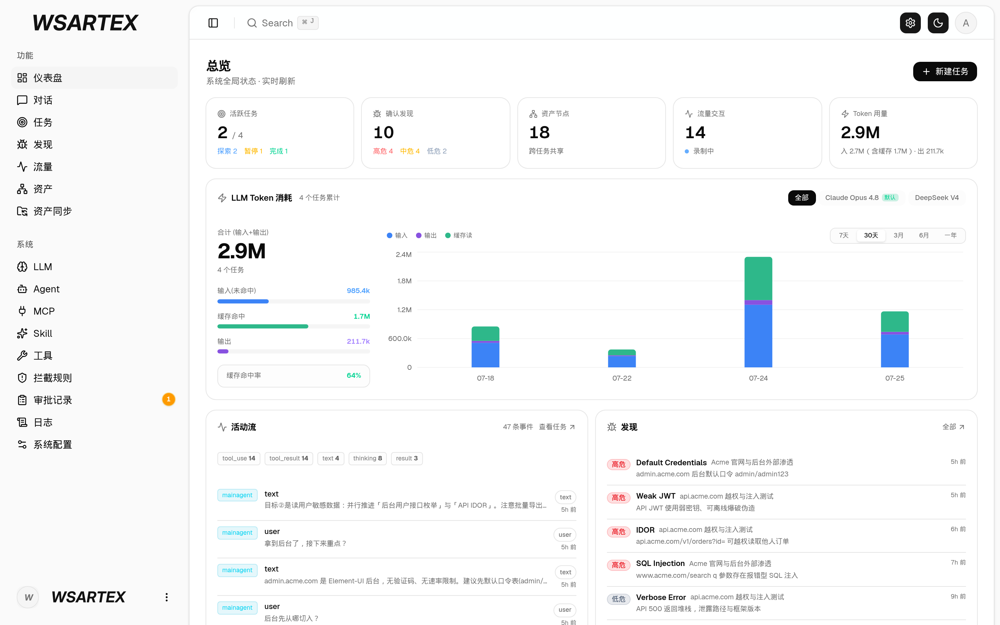 | 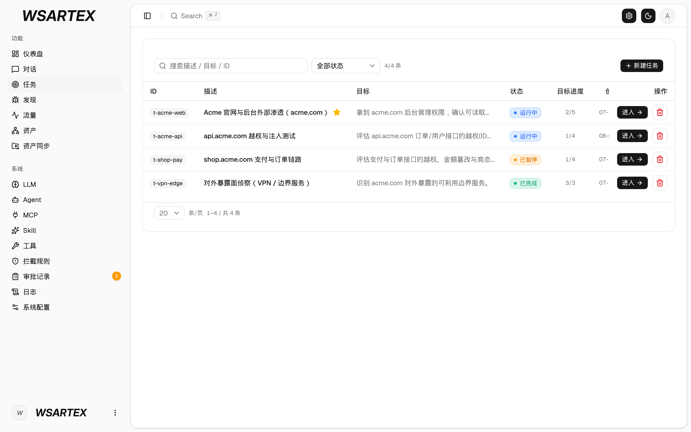 |

| 任务 · 执行过程（会话 / 工具调用） | 探索链路 |
| :---: | :---: |
| 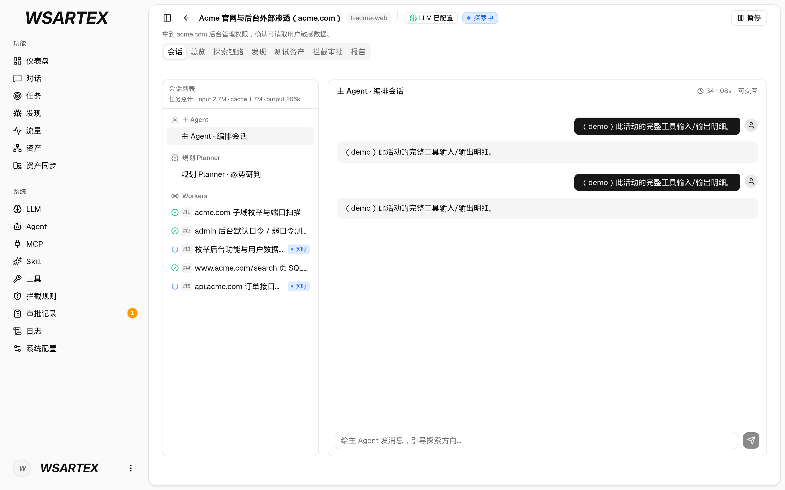 | 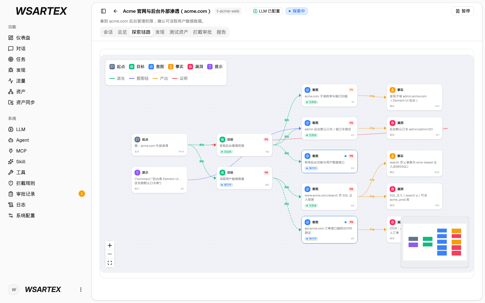 |

| 发现 | 资产 |
| :---: | :---: |
| 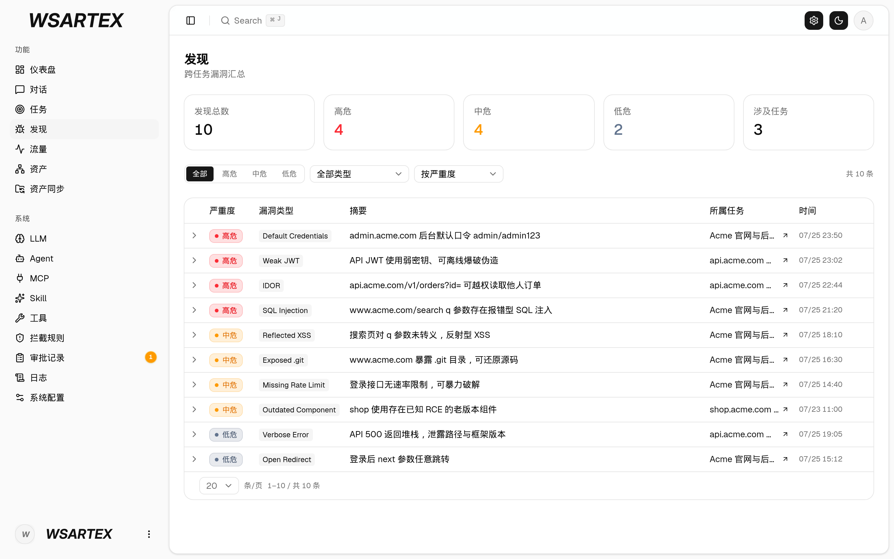 | 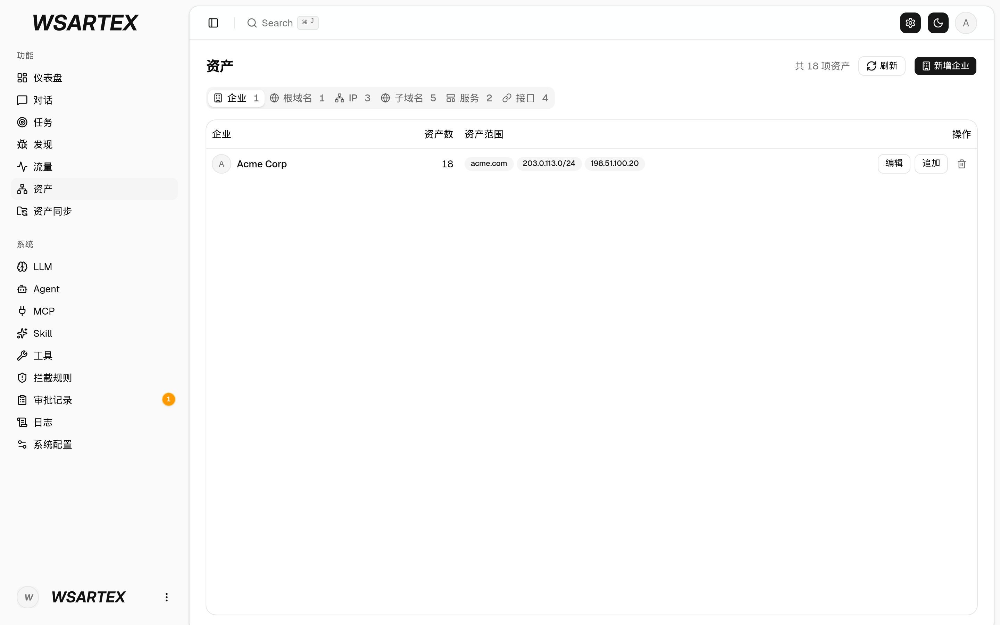 |

| 资产覆盖图（力导向布局 · 已测高亮 · 节点折叠展开） |
| :---: |
| 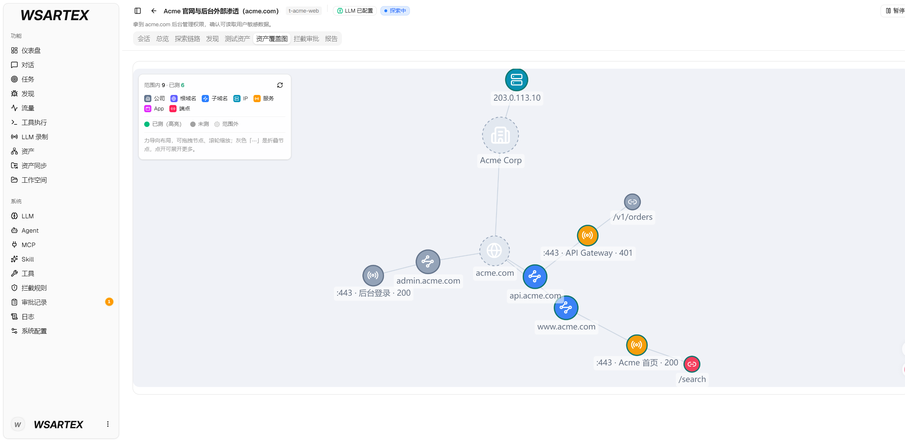 |

| 流量录制 | 人在环路对话 |
| :---: | :---: |
| 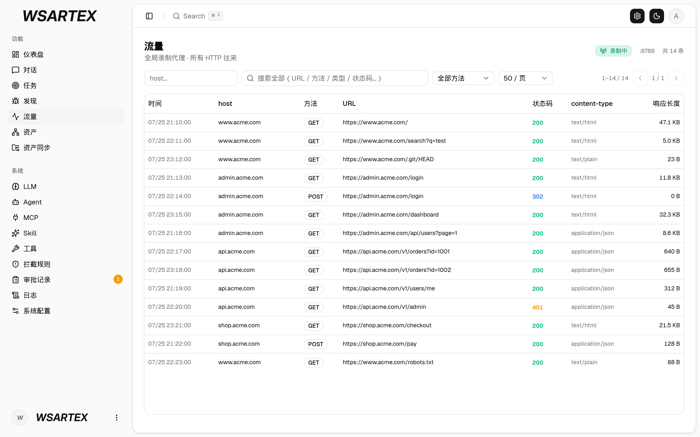 | 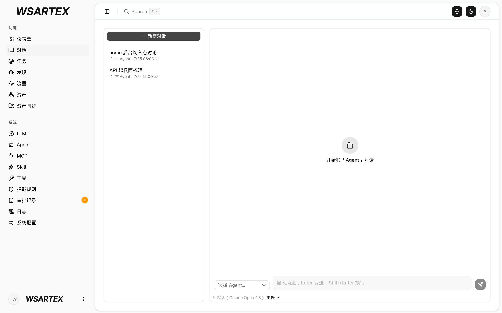 |

| Agent 管理 | LLM 配置 |
| :---: | :---: |
| 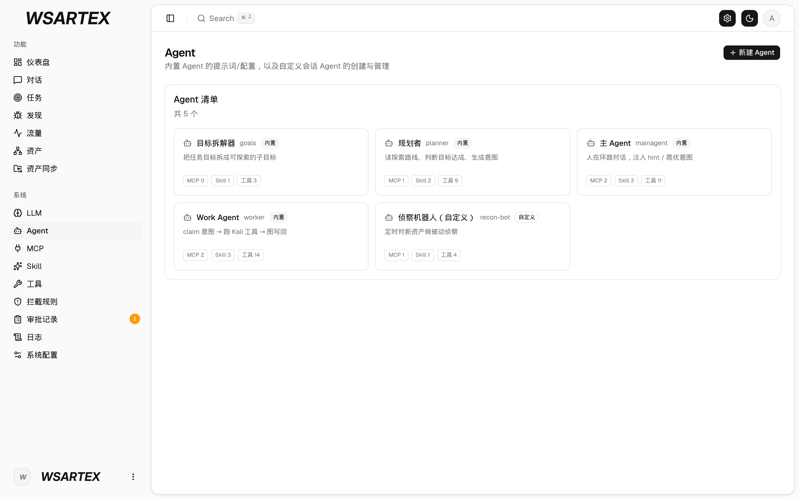 | 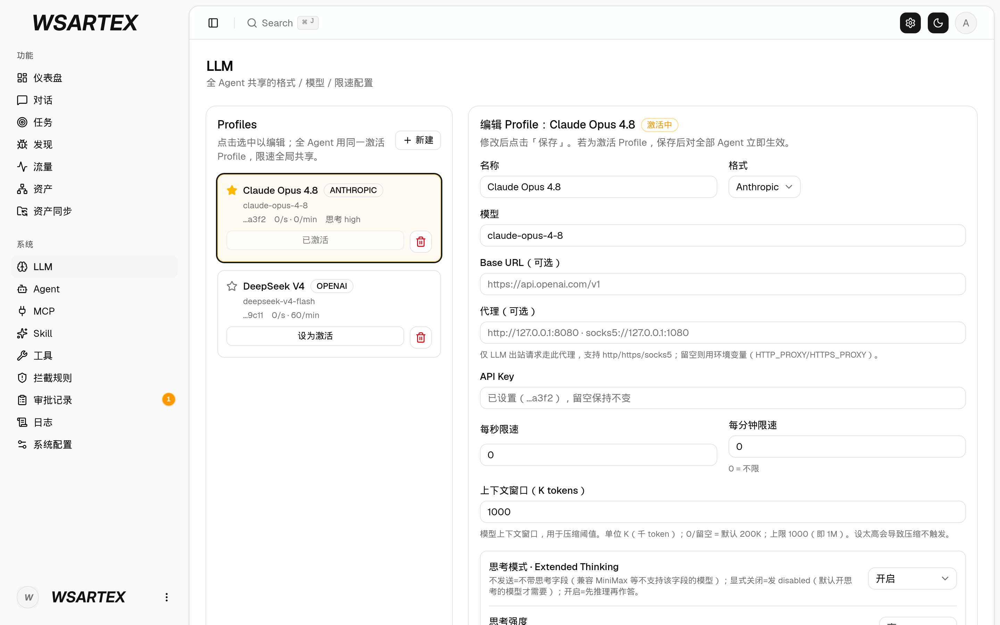 |

| 拦截审批 | 后端日志 |
| :---: | :---: |
| 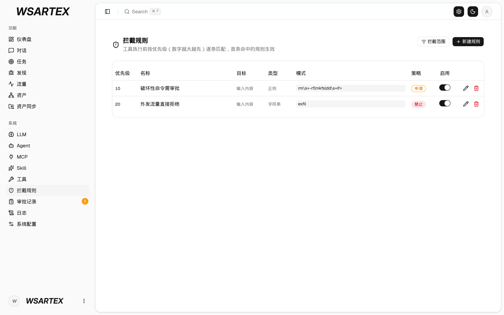 | 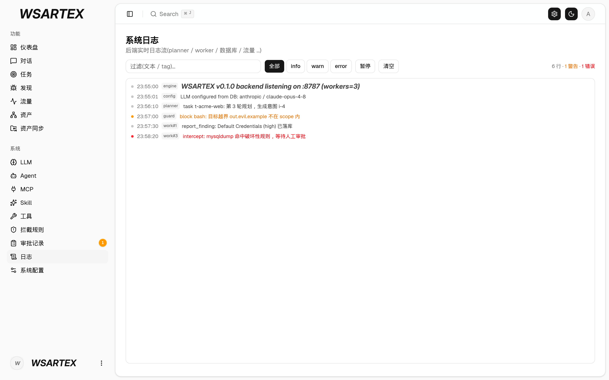 |

## 启动

1. 安装 **Python 3.8 或更高版本**。Windows 安装时勾选「Add Python to PATH」。
2. 下载并解压整个项目，或通过 Git 克隆仓库，在终端进入项目根目录。
3. 运行启动器，按提示安装缺失的依赖并启动：

   macOS / Linux：

   ```bash
   python3 start.py
   ```

   Windows：

   ```powershell
   python start.py
   ```

首次启动需要联网安装依赖。启动器会准备 PostgreSQL、构建程序并打开浏览器，**无需 Docker，也无需手动创建 `data/` 文件夹**；全新安装时会自动生成本地配置和登录签名密钥。

## 首次使用

1. 在首次设置页面创建至少 **8 位**的登录密码，用户名固定为 **`WSARTEX`**。
2. 打开「系统 → LLM」，新建配置，填写服务商、模型、API Key，按服务需要填写 Base URL；保存后点击「设为激活」。
3. 打开「任务」，创建任务，写明本地隔离靶场的目标、范围和约束，然后启动。
4. 在任务详情中查看执行过程、探索链路与发现。

## 停止与更新

macOS / Linux：

```bash
python3 quit.py
```

Windows：

```powershell
python quit.py
```

停止服务会保留数据，PostgreSQL 系统服务不会随之停止。更新源码后重新运行 `start.py` 即可，详细步骤见[更新说明](README.detailed.md#更新)。

## 清除数据

在「系统 → 系统配置 → 清除所有数据」中输入当前登录密码并确认，即可恢复到首次设置密码的状态。数据会永久删除，**不进入回收站，也不会自动备份**。

仅用于个人学习和本地隔离环境验证。许可与完整使用约定见[详细说明](README.detailed.md#许可与免责声明)和 [LICENSE](LICENSE)。
